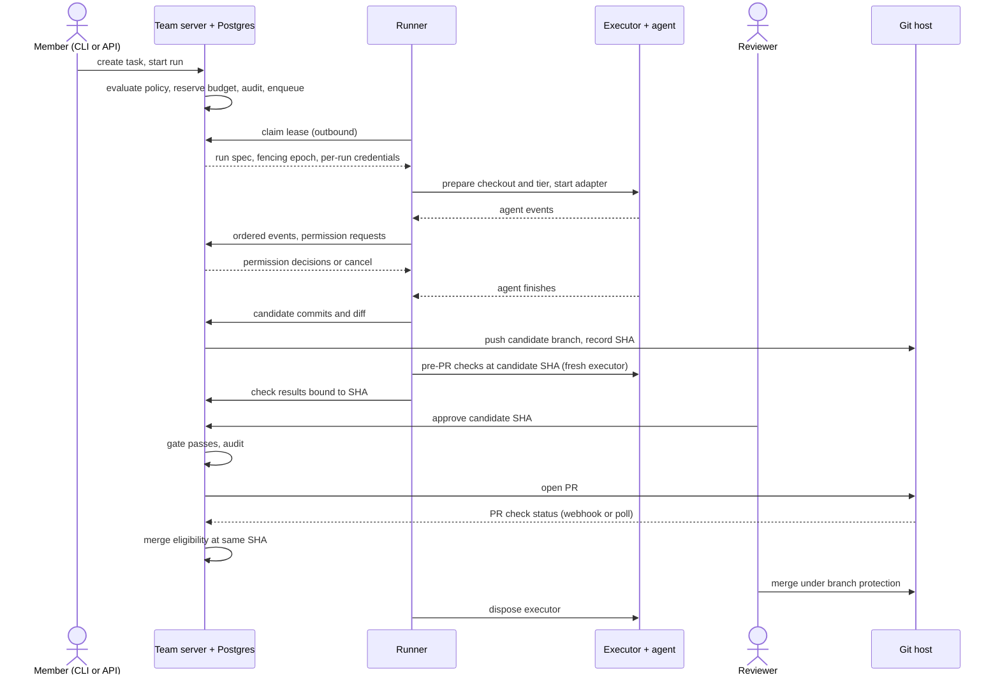
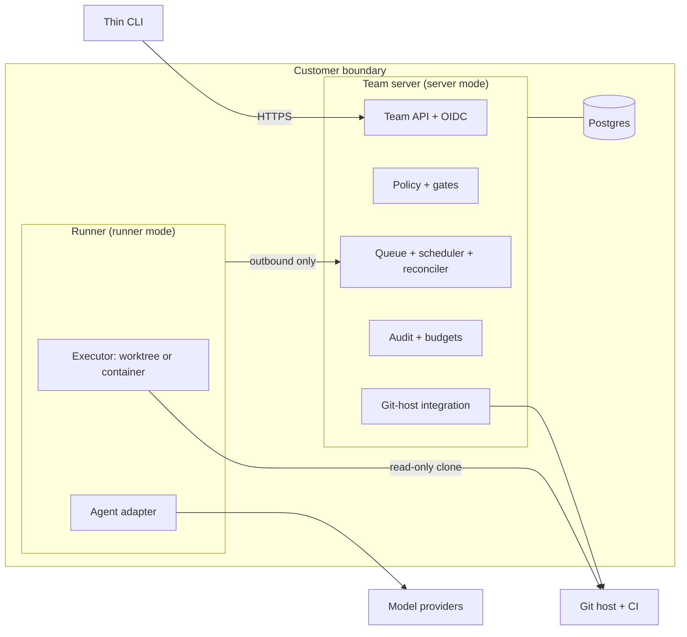
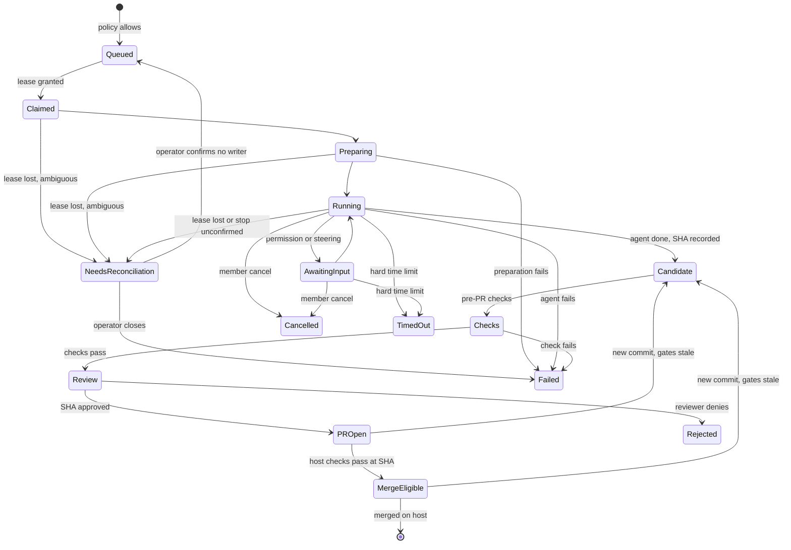

# HLD-000 Platform overview HLD

> Status: APPROVED v3 on document quality (final check 2026-11-26 by a different-model reviewer: findings 1-22 closed, no new findings; see HLD-000-platform-overview.review.md). HOLD: the seven R3 §G experiments are UNRUN; the maintainer lifts this hold by recording their results in the Action Items. Implementation plans may be drafted against this HLD but no code is written while the hold stands.
> HLD = architecture decisions, system boundaries, options analysis, data flows.
> No class names, config keys, or test file names (those belong in the LLD).
> Every decision cites its source (research doc §, measurement, or "verified-by: <how>").

> Inputs: VISION APPROVED v2; PRD-000 APPROVED v2; R2 APPROVED v2; R3 APPROVED v4; R1 APPROVED v2. Scope: the first three-month (12-week) self-hosted alpha.
> Citation keys: "R2 S46" is source S46 in R2's source list; R1 and R2 number sources separately. R2 section keys are expanded under References.

## Background

Teams run several coding agents in parallel, each on its own repo copy, then review and merge; each vendor ships a surface for its own agent (VISION §The one-paragraph thesis; R1 §3a, §4). Platform and DevEx teams (payers) want that work inside their boundary, across vendors, with per-repo policy, budgets and audit; engineering teams (users) want shared, gated fleets instead of worktree scripts (VISION §Who it is for; PRD §Problem and users).

Prior attempts narrow the gap: Conductor has no self-hosted control plane; GitHub Agent HQ is cross-vendor inside one host's cloud; OSS conductors ship servers and remote clients; Coder sells self-hosted governance in paid tiers; Stripe, Ramp and Spotify built their own harnesses (R1 §1, §4, Analysis; R2 §5; R3 §C). The gap is a customer-hosted, cross-vendor control plane with gates and audit in its open edition (R1 Analysis; MED).

Phase 0 changed three premises. Checkout separation is not isolation: worktrees share host network and credentials, containers share the kernel, microVMs are stronger but prove no zero exfiltration (R2 §1). ACP, MCP and A2A are complementary, none a job specification; ACP tool permission is not change approval (R2 §2). Vendor policy can change overnight, so adapters cannot rely on consumer login (R2 §2; R3 §C).

The approved stance is option B (team server, self-hosted runners, worktree and container executors, Postgres) inside option C's provider-neutral boundaries, shipped as an OSS self-hosted team server with a thin client (VISION §Strategy; R2 §Options; R3 §D). This HLD fixes platform boundaries, the PRD's handoffs and the cross-cutting model for the alpha; component HLDs and LLDs follow (PHASE-1 §Open after Phase 1).

## Glossary

| Abbreviation | Full form | Description |
|---|---|---|
| A2A | Agent2Agent | Protocol between independently deployed, opaque agents (R2 §2). |
| ACP | Agent Client Protocol | Client-to-coding-agent JSON-RPC protocol; tool permission, not change approval (R2 §2). |
| Candidate SHA | Candidate commit SHA | Commit a gate decision binds to; any change stales it (VISION §Design principles). |
| Fencing epoch | Lease generation number | Monotonic lease number; writes with an older one are rejected (R2 §Analysis/Durability). |
| KVM | Kernel-based Virtual Machine | Linux virtualization Firecracker needs (R2 S04). |
| MCP | Model Context Protocol | Host-to-tools protocol; no supervision semantics (R2 §2). |
| OIDC | OpenID Connect | Core sign-in protocol for P0 users (PRD FR-34). |
| P0 / P1 | Release priority | P0 must pass before the alpha; P1 is later or partner-dependent (PRD §Functional requirements). |
| SCIM / SSO | System for Cross-domain Identity Management / single sign-on | Enterprise identity provisioning and federation (R3 §B). |
| trusted-local | Unsandboxed worktree tier | Worktree runs sharing the runner host's user, network and credentials (PRD FR-10). |

## P0 Scope

The first release is the PRD's 12-week self-hosted alpha for one organisation (PRD §P0 scope). R2 judges this slice credible for a small team (R2 §Scope, LOW).

P0 includes:

- One product binary in server or runner mode; one Compose file deploys server, Postgres and one runner; more runners join from other hosts (PRD §P0 scope; FR-12, FR-31).
- An authenticated headless team API and a thin CLI (PRD FR-27, FR-28; option set 1 A).
- Two production-path agent adapters, at least one driven through its local CLI (PRD FR-4).
- Two executors: `trusted-local` worktree and hardened container (PRD FR-10, FR-11).
- Up to two Git hosts with a tested PR path: GitHub plus GitLab provisionally, or GitHub only if pilot demand is GitHub-only; pilot evidence chooses before HLD approval (PRD option set 3; FR-19, FR-20).
- Org and repo policy, SHA-bound fail-closed gates, budgets and append-only audit in the Apache-2.0 core (PRD FR-16 to FR-25).
- Single-org roles with OIDC sign-in (PRD FR-26, FR-34).
- Versioned extension boundaries (PRD FR-29).
- Opt-in heartbeat, off by default (PRD FR-32).
- Backup, restore and a documented schema-compatible upgrade (PRD NFR-8).

Why limited to this: the open core must run task -> run -> diff -> gate -> PR without a paid module (VISION §Design principles; R3 §B); more providers, tenancy, HA or per-agent parity need buyer evidence and a threat review first (R2 §Scope).

**Pre-HLD experiment record (PRD §Handoffs item 9).** As of 2026-11-26 none of the seven R3 §G experiments has a result (VISION §How we will know); dependent assumptions are marked UNRUN. VISION requires all seven before any HLD is approved, so review proceeds but approval waits (Action Item 1). Row 8 is the additional pilot threat review the PRD names (PRD Assumption 5, §Handoffs item 3), not an R3 §G item.

| # | Experiment | Status | Dependent assumptions |
|---|---|---|---|
| 1 | Payer kill test | UNRUN | 1, 2, 4, 9, 10 |
| 2 | Leaver/stayer interviews | UNRUN | 5, 6 |
| 3 | Segmented landing page | UNRUN | 5, 11, 14 |
| 4 | Audience 3b conversations | UNRUN | 11 |
| 5 | Fake-door pricing | UNRUN | 14 |
| 6 | Issue-tracker mining | UNRUN | 6 |
| 7 | Written vendor check | UNRUN | 3 |
| 8 | Pilot threat review (additional) | UNRUN | 2, 9 |

## Requirements

PRD-000 requirements this HLD satisfies in P0, carrying section in brackets; each traces through PRD-000 to VISION and R1 to R3.

**Functional**

1. Team workflow and surfaces: FR-1, FR-2, FR-3, FR-27, FR-28 [§1, §2].
2. Agents and capabilities: FR-4, FR-5, FR-6 [§4]; the pair itself depends on Assumption 3.
3. Checkout, execution tiers and runners: FR-9, FR-10, FR-11, FR-12 [§3].
4. Run control and recovery: FR-13, FR-14 [§5].
5. Candidate, gates and PR path: FR-15 to FR-19, and FR-20, P1 that "becomes P0 if option set 3 resolves to A before HLD approval" (PRD FR-20) [§6, §7].
6. Policy, audit and budgets: FR-21 to FR-24, and FR-25 including the monetary threshold warning [§6].
7. Roles and identity: FR-26, FR-34 [§8].
8. Extension boundaries: FR-29 [§9].
9. Install and telemetry: FR-31, FR-32 [§10, §11].

**Non-functional**

10. Install time NFR-1 and latency evidence NFR-2: recorded per stage; pass only when measured (Assumption 10) [§10, §11].
11. Recoverable availability NFR-3 [§5, §11].
12. Execution isolation NFR-4 [§3, §11].
13. Authorisation and confidentiality NFR-5 [§3, §7, §8, §11].
14. First-release tenancy NFR-6 [§8].
15. Bounded operating cost NFR-7 [§3, §11].
16. Upgradeability NFR-8 [§10].
17. Compatibility and licensing NFR-9 [§5, §9].
18. Audit integrity NFR-10, including the retention decision the PRD assigns here [§5, §6].

**Derived (this HLD)**

19. A shared durable queue with claims, leases and reconciliation, from the team-server requirement (R2 §Options) [§3.3, §5].
20. Pre-PR checks run at the candidate SHA in a fresh executor, not the agent's session, from FR-16 and NFR-4 [§6].
21. Git-host write credentials stay on the server; runners hold read-only per-run credentials, from FR-17 and NFR-5 [§7].

P1 requirements FR-7, FR-8 and FR-30 get a seam, not a build (Out of Scope 6, 7, 9); FR-20 stays P1 with a seam unless option set 3 resolves to A before HLD approval (Out of Scope 8). FR-33 is withdrawn in the PRD. No P0 requirement is left unsatisfied by design.

## Out of Scope

1. Hosted edition: hosted PRD and HLD, after paying self-hosted customers (PRD Out of scope 1; R3 §B, §D).
2. Embeddable B2B2B or customer-tenant API: embedder PRD and tenancy HLD, only after two 3b letters of intent (PRD Out of scope 2; R3 §G item 4).
3. Secure multi-org, multi-customer tenancy: tenancy HLD; P0 keeps only the seam in §8 (PRD Out of scope 3).
4. Enterprise module contents (listed in §9): Enterprise PRD and HLD, contingent on Assumption 1 (PRD Out of scope 4; R3 §B).
5. MicroVM tier and external sandbox providers: execution/sandbox-adapter HLD; seam in §3 (PRD Out of scope 5; R2 §Scope).
6. FR-7, ACP ingestion (P1): agent-adapter HLD; seam in §4.
7. FR-8, policy-scoped MCP tools (P1): agent-adapter and policy HLDs; seam in §4.
8. FR-20, second Git host, unless PRD option set 3 resolves to A before HLD approval; a third Git host in any case (PRD option set 3: "never exceed two Git hosts in this slice"): Git-host component LLD; seam in §7.
9. FR-30, operator branding (P1, Enterprise): Enterprise HLD; extension point in §9.
10. Public plugin marketplace and untrusted server-side plugins: extension-point LLD and security review (PRD Out of scope 6).
11. Desktop, web, mobile and IDE clients: later, if pilots select PRD option set 1 B or C (PRD Out of scope 7).
12. Merge automation: a later policy-and-gates HLD (PRD Out of scope 9).
13. Guaranteed dollar caps for opaque agents, compliance certifications and zero-exfiltration claims (PRD Out of scope 8).
14. Hostile-code workloads such as external contributions: sandbox-adapter HLD with a microVM tier; ineligible in P0 (§3.2; PRD Goal 6).
15. HA, zero-downtime upgrades and air-gap packaging: Enterprise HLD (PRD §P0 scope; NFR-8; R3 §B).
16. Tamper-evident audit chains, signing and export: policy-and-gates and Enterprise HLDs (R2 §Analysis/Execution; PRD §Handoffs item 6).
17. Import of other conductors' settings: later onboarding requirements (R1 §5).
18. More than one runner OS and architecture: later execution HLD (PRD §P0 scope).
19. No-Postgres single-user local mode: a later local-mode HLD (§5 Option 7).

## Assumptions

Each, if false, changes the section named. UNRUN marks dependence on an experiment with no result (P0 Scope record).

1. **A payer exists for the enterprise split [UNRUN R3 §G item 1].** If the kill test fails, §9's Enterprise module is not built; the core stands (PRD Assumption 1).
2. **Pilot lower-trust work is cooperative or controlled, not hostile code [UNRUN R3 §G item 1, record row 8].** If pilots need hostile-code execution, the microVM tier moves into the alpha (PRD Assumption 5; R2 §Open questions).
3. **The first agent pair can run on permitted API-key or enterprise billing [UNRUN R3 §G item 7].** If a vendor rules an integration out, §4 swaps that adapter for an open harness (PRD Assumption 4, option set 2 B).
4. **GitHub plus GitLab, or GitHub alone, covers the first partners [UNRUN R3 §G item 1; partner repo survey not run].** If a partner needs another host, §7.1 swaps the selected host within the two-host cap; the contract stands (PRD Assumption 6).
5. **Teams use more than one agent [UNRUN R3 §G items 2 and 3].** If not, §4's contract stays but deeper multi-agent work is deferred (PRD Assumption 3).
6. **Shared gates and audit meet a need beyond existing OSS servers [UNRUN R3 §G items 2 and 6].** If not, §6's investment is revisited (PRD Assumption 2).
7. **Postgres-only orchestration is enough for agent run lifetimes in the alpha.** If timers, compensation and replay become central, §5 reassesses Options 2 and 3 (R2 §Analysis/Durability, MED).
8. **The supported runner OS can run a rootless or user-namespaced container runtime.** If not, §3's container hardening and §10's install change; verified-by: runner LLD spike (R2 S03).
9. **Pilots accept model-provider egress from executors [UNRUN R3 §G item 1, record row 8].** If strict no-egress is required, vendor CLIs are ineligible and §3, §4 need an open harness with a local model (PRD Assumption 5; R3 §F Q5).
10. **The NFR-1 prerequisites (host, container runtime, OIDC test client, credentials) allow a one-hour first run [UNRUN R3 §G item 1; install benchmark not run].** If setup dominates, §10's target is redefined (PRD Assumption 7).
11. **The embedder is not the launch buyer [UNRUN R3 §G items 3 and 4].** If two 3b letters of intent arrive, a tenancy HLD activates §8's seam; P0 does not widen (PRD Assumption 9).
12. **The core stays Apache-2.0 and customers may serve their own customers.** If either changes, §9 and the I2 eliminations (Appendix A) reopen (VISION §Strategy; R3 §B, Handoffs).
13. **Agent headless event formats stay stable enough for golden fixtures in the alpha.** If not, §4's adapters need a faster cadence (PRD option set 2, ADVISORY con).
14. **Opt-in heartbeat yields enough evidence to assess adoption [UNRUN R3 §G items 3 and 5].** If opt-in is sparse, §11 reports the rate without generalising (PRD Assumption 8).

## Design

Invariants used as BLOCKING criteria. Each is stated once and carries the same tag in every option it touches; a con shared by every option in a set is ADVISORY (LEARNINGS L3).

- **I1 Customer-hosted team control plane.** The shared server runs inside the customer's boundary (VISION §Strategy invariants; PRD §P0 scope).
- **I2 Licence boundary.** The core is Apache-2.0; it neither bundles nor hard-depends on a BSL, SSPL or other non-OSI server, and embeds no AGPL source (R3 §B; PRD NFR-9; R2 §Analysis/Self-host).
- **I3 Open core runs the defining workflow.** task -> run -> diff -> gate -> PR completes with the core's own worktree and container executors and two adapters (VISION §Design principles; PRD FR-3, FR-4, FR-11).
- **I4 Execution cannot approve or merge.** No runner or agent identity can approve, merge or write gate decisions (PRD FR-17, FR-26, NFR-5).
- **I5 Gate sequencing.** Gates bind to the candidate SHA and fail closed; a gate cannot depend on an event it precedes (PRD FR-16; LEARNINGS L36).
- **I6 Host authority.** The PR is created after the human gate and code-host branch protection is never bypassed (PRD FR-18, Out of scope 9).
- **I7 Single Compose, no workflow cluster.** Server, Postgres and runner install from one Compose file, and a first run needs no workflow-engine cluster installed outside it (PRD FR-31, NFR-9).
- **I8 No untrusted code in the server.** Extension boundaries are versioned, no untrusted plugin code runs in the server process, and an extension cannot gain server privileges by registering itself (PRD FR-29).
- **I9 Audit before privilege.** A privilege transition commits only with its audit event (PRD FR-22, NFR-10).
- **I10 Hard ceilings.** Time and concurrency ceilings hold at run and repo/org scope (PRD FR-24).
- **I11 No paid sandbox required.** A clean install completes the workflow without a paid hosted sandbox (PRD NFR-7).
- **I12 Lower-trust confinement.** A lower-trust run gets no host checkout, host agent credential or container daemon socket (PRD FR-11, NFR-4; VISION §Design principles).

### 1. End-to-end workflow

The defining workflow, task -> run -> diff -> gate -> PR, as it crosses the boundaries decided in §2 to §10 (VISION §Design principles; R2 §Analysis/Execution pipeline).

| # | Description |
|---|---|
| 1 | A member creates a task on a configured repo and starts a run with an agent and executor (FR-1, FR-2). |
| 2 | The server evaluates policy, reserves budget and writes run, audit event and queue entry in one transaction; a denied run is never queued (FR-21, FR-22, FR-25; §5, §6). |
| 3 | An eligible runner claims the run outbound under a fenced lease and receives per-run credentials: read-only repo access and the agent's API key (FR-12; §3.3, §7.2). |
| 4 | The runner creates a fresh checkout and branch in the run's tier: worktree, or inside a hardened container with no host mount (FR-9 to FR-11; §3). |
| 5 | The adapter starts the agent; events stream to the server and are stored in order (FR-2, FR-5; §4, §5). |
| 6 | Tool-permission requests are decided by policy or a member; they never approve a change (FR-5; R2 §2; §4). |
| 7 | Cancel and the hard time limit stop new tool work; the run ends Cancelled (member cancel), TimedOut (time limit), NeedsReconciliation (stop unconfirmed) or Failed (agent or preparation failure) (FR-13, FR-24; §5). |
| 8 | The runner commits outside the agent's control and transfers commits and diff; the server pushes the candidate branch with its own identity and records the SHA (FR-15; §7.2). |
| 9 | Pre-PR checks run at the candidate SHA in a fresh executor of the same tier; results bind to that SHA (FR-16; §6.1). |
| 10 | A distinct authorised reviewer sees diff, SHA and checks and approves or rejects that SHA (FR-15, FR-17). |
| 11 | With approval and checks current at that SHA and audit committed, the server opens exactly one PR (FR-16, FR-18, FR-22). |
| 12 | The host runs PR-triggered checks; the server reads them by webhook and poll and computes merge eligibility at that SHA; a new commit stales every gate (FR-16; §7). |
| 13 | A human merges on the host under branch protection; baton never merges (FR-18; PRD Out of scope 9). |
| 14 | The runner disposes the executor; audit reconstructs the run (FR-23). |

### 2. Control plane shape and the team-server boundary

**Question:** what is the control plane, what runs on the server, the runner and the thin client, and does baton build bounded runner plumbing (B inside C), ship C's full provider matrix, or reuse an OSS daemon or platform (E)? (PRD §Handoffs item 1; VISION §Open questions item 5; R2 §Options.)

**Option 1: B inside C, a baton team server and baton runners behind provider-neutral contracts (Preferred)**

| Component | Responsibilities | Runs where |
|---|---|---|
| Team server | API, OIDC, roles, policy, queue, leases, reconciler, gates, audit, budgets, Git-host I/O, extension registry, heartbeat | Customer host (Compose) |
| Postgres | System of record (§5) | Customer host (Compose) |
| Runner | Outbound claims, checkout, executors, adapters, events, local ceilings, commit capture, pre-PR checks, cleanup | Customer host or VM |
| Executor | One checkout and process boundary per run (§3) | Runner host |
| Thin CLI | Calls the team API with a user token | Member's machine |
| Git host | Code, branch protection, PR-triggered CI, merge | Customer's host |

**Pros:**
1. baton owns the queue, gates and audit end to end, so I3 and I5 are under its control (R2 §Options B).
2. Smallest deployable team server: one binary plus Postgres in Compose, with outbound runners (R2 §Options B; R2 S46).
3. baton-owned first-party core code is Apache-2.0, so no reused server needs licence review; dependencies still pass the licence check (Action Item 11; R3 §B).
4. Provider-neutral contracts admit C's providers later without control-plane change (R2 §Options C, §Handoffs).

**Cons:**
1. [ADVISORY] Rebuilds runner plumbing that OSS daemons already ship (R2 §5, S68 to S72).
2. [ADVISORY] Fixed P0 executors postpone external sandbox and Coder integration (R2 §Options B).
3. [ADVISORY] Runners and Postgres add operations for the customer (R2 §Options B).
4. [ADVISORY] Agent neutrality and sandbox enforcement are implementation risks shared by every option (R2 §Options).

**Why is this option preferred?** No BLOCKING con; the smallest design keeping every invariant under baton's control, and R2's preference, "B first, within C's boundaries" (MED). It is C's bounded first step, and reversible toward Option 3 or 4 if the B-versus-E spike (Action Item 2) shows reuse is faster without weakening I2, I3 or I5.

**Option 2: Full C, a neutral control plane with independently pluggable agent and sandbox providers in the alpha.** **Pros:** 1. Customer-owned Coder, GitHub-hosted Codespaces or VM backends keep one gate and audit model (R2 §Options C; R2 S55, S77). **Cons:** 1. [ADVISORY] A general plug-in ABI and certified provider matrix exceed a quarter. 2. [ADVISORY] Provider lifecycle and billing edge cases. 3. [ADVISORY] Vendor model calls may still leave customer infrastructure (cons 1 to 3: R2 §Options C). 4. [ADVISORY] Shared neutrality and sandbox risk, as Option 1 con 4.

**Why not preferred:** no BLOCKING con (R2: "No inherent BLOCKING con"); not preferred on advisory grounds: Option 1 is this boundary with R2's mitigation, "ship two agents/two executors, not every provider", and its seam leads here (Out of Scope 5).

**Option 3: E, reuse an Apache-2.0 OSS daemon (Paseo-class) as runner plumbing under a baton server**

**Pros:**
1. An Apache-2.0 daemon, licence-compatible with the core, with SDK, Docker self-host and plugins (R2 S69; R3 §B).

**Cons:**
1. [ADVISORY] Forking risks upstream divergence (R2 §Options E).
2. [ADVISORY] Task, gate and merge durability still has to be built (R2 §Options E).
3. [ADVISORY] Lease, fencing and outbound-only behaviour undocumented in approved sources (UNVERIFIED).
4. [ADVISORY] Its upstream offers team features that compete with baton's (R3 §C).
5. [ADVISORY] Shared neutrality and sandbox risk, as Option 1 con 4.

**Why not preferred:** no BLOCKING con; advisory grounds only (R2 §Options E). Viable; the spike decides.

**Option 4: E, integrate customer-installed Coder through its API as the execution substrate**

**Pros:**
1. Customer workspaces on VMs, containers or Kubernetes through Terraform templates (R2 S55).
2. Out-of-process API use imports no AGPL source (R2 §Options E).
3. Matches R3's advice to integrate Coder as a provider (R3 §D, Recommendations).

**Cons:**
1. [ADVISORY] A second platform to install lengthens the NFR-1 path (inference).
2. [ADVISORY] Coder's paid governance overlaps baton's gates (R2 §Options E; R2 S56).
3. [ADVISORY] Shared neutrality and sandbox risk, as Option 1 con 4.

**Why not preferred:** no BLOCKING con while baton keeps its own executors beside it; on advisory grounds it fits as a later C provider (Out of Scope 5). A variant replacing baton's executors fails I3.

**Option 5: E-embedded, embed Coder's server or source in the core**

**Pros:**
1. One integrated workspace platform.

**Cons:**
1. [BLOCKING] Embeds AGPL source in an Apache-only core, violating I2 (R2 §Options E; R3 §B).
2. [ADVISORY] Adds a large dependency surface.

**Why not:** infeasible because of con 1 alone; con 2 is advisory and overruling it does not change this verdict.

**Option 6: A, local-first daemon and UI with no shared server**

**Pros:**
1. Simplest local setup with object reuse (R2 S01, S68, S69).

**Cons:**
1. [BLOCKING] No shared server, so no customer-hosted team control plane: violates I1 (R2 §Options A).
2. [ADVISORY] A crowded OSS slot (R1 Analysis).

**Why not:** infeasible because of con 1 alone; con 2 is advisory and overruling it does not change this verdict.

**Option 7: D, vendor-hosted control plane with customer-side runners only**

**Pros:**
1. Little customer control-plane operation; Claude and Cursor show customer-side execution (R2 S30, S75).

**Cons:**
1. [BLOCKING] The central software is not customer-hosted, violating I1 (R2 §Options D).
2. [ADVISORY] Transcripts and model inputs still leave the customer (R2 S30, S75).

**Why not:** infeasible because of con 1 alone; con 2 is advisory and overruling it does not change this verdict.

**Comparison table**

| Criterion | 1 B in C | 2 Full C | 3 OSS daemon | 4 Coder API | 5 Coder embedded | 6 A | 7 D |
|---|---|---|---|---|---|---|---|
| Customer-hosted team plane (I1) | Yes | Yes | Yes | Yes | Yes | No | No |
| Licence boundary (I2) | Yes | Yes | Yes | Yes | No | Yes | n/a |
| Gates and audit owned by baton | Yes | Yes | Yes | Yes | Yes | No | Vendor |
| Extra platform to operate | No | Per provider | No | Coder | Coder | No | Vendor |
| BLOCKING | None | None | None | None | I2 | I1 | I1 |

Verdict from BLOCKING items alone: Options 5, 6 and 7 are eliminated; Options 1 to 4 survive and BLOCKING items cannot rank them. Option 1 is preferred on advisory grounds, matching R2's verdict.

### 3. Execution model and trust tiers

**Question:** how do checkout separation and isolation relate, which tier serves lower-trust work by default (VISION §Open questions item 4; PRD Open question 5), and how do runners talk to the server (PRD §Handoffs item 3)?

One versioned executor-provider contract declares lifecycle (create, stop, dispose, list orphans), checkout import and artifact export, egress and secret capabilities, and failure ownership (provider reports, reconciler decides). P0 ships worktree and container; Coder, Codespaces, E2B, Daytona and Vercel come later (R2 §Handoffs; R2 S55, S77).

#### 3.1 Tier model

**Option 1: Checkout always separate; isolation a separate, labelled tier (Preferred)**

Every run gets its own checkout and branch (FR-9). Tier is a policy attribute shown before dispatch (FR-10): `trusted-local` (worktree from a runner-owned mirror, or a clone where submodules need it, R2 S01, S02), hardened container (checkout in the container's own volume), and a reserved microVM tier (Out of Scope 5). Checkout paths are confined; symlinks and traversal are rejected (R2 §Analysis/Execution).

**Pros:**
1. Matches R2's finding that checkout separation is not isolation (R2 §1).
2. Lets cheap cooperative work and lower-trust work coexist under one policy (R2 §1 isolation table).

**Cons:**
1. [ADVISORY] Two executor paths to build and test (R2 §Scope).

**Why is this option preferred?** No BLOCKING con; it is the only option satisfying I3 and FR-10 together.

**Option 2: Worktree only, all runs `trusted-local`**

**Pros:** 1. Fastest and cheapest (R2 §1).
**Cons:** 1. [BLOCKING] No container executor, so I3 fails (FR-11). 2. [ADVISORY] Host credentials exposed to every run (R2 S01).
**Why not:** infeasible because of con 1 alone; con 2 is advisory and overruling it does not change this verdict.

**Option 3: Container only, no `trusted-local` tier**

**Pros:** 1. One security posture for every run.
**Cons:** 1. [BLOCKING] No worktree executor, so I3 fails (FR-4 acceptance needs both). 2. [ADVISORY] Image and setup cost for cooperative work (R2 S03).
**Why not:** infeasible because of con 1 alone; con 2 is advisory and overruling it does not change this verdict.

**Option 4: Tier implied by checkout type (clone treated as isolated)**

**Pros:** 1. No separate tier attribute.
**Cons:** 1. [BLOCKING] A clone is not a security boundary (R2 S02), so the label would misstate isolation, violating FR-10. 2. [ADVISORY] Hides the choice from policy.
**Why not:** infeasible because of con 1 alone; con 2 is advisory and overruling it does not change this verdict.

#### 3.2 Default tier for lower-trust work

The trade: hosted providers bill per second and differ on persistence, egress and secrets (R2 §1 provider table, S05 to S19, S79, S80); a hardened container (rootless, dropped capabilities, seccomp, no daemon socket, quotas, egress policy) shares the runner's kernel (R2 S03).

**Option 1: Hardened container by default, with a bounded eligibility envelope (Preferred, conditional on the pilot threat review)**

Repos default to the container tier; `trusted-local` is a per-repo org-admin opt-in. The container tier takes cooperative and controlled work on the org's own repos; hostile code is refused in P0, not downgraded (PRD Goal 6; Out of Scope 14). Egress is deny by default with model-provider and package allowlists (FR-21). This default is conditional on the UNRUN pilot threat review (record row 8). PRD §Handoffs item 3: "Record the pilot tier or mark it unresolved if §G results are still unrun"; the pilot tier is unresolved (Assumption 2), and approval waits for it (Action Item 3).

**Pros:**
1. Self-hostable with no paid account (I11; R2 S03).
2. Within the 12-week slice R2 scopes (R2 §Scope).
3. Fail-closed default: convenience requires an explicit admin choice.

**Cons:**
1. [ADVISORY] Shared kernel; not a hostile-code boundary (R2 §1 isolation table).
2. [ADVISORY] Agent code can read secrets injected into its environment, as with several providers (R2 S79); mitigated by per-run scoped keys and egress allowlists.

**Why is this option preferred?** No BLOCKING con; it meets I11 and I12 at the lowest operating cost, its weakness bounded by eligibility.

**Option 2: Self-operated microVM (Firecracker) by default**

**Pros:** 1. Stronger untrusted-code boundary (R2 §1 isolation table).
**Cons:** 1. [ADVISORY] KVM, jailer, images, volumes and a credential broker to build and operate (R2 S04). 2. [ADVISORY] Outside R2's 12-week slice (R2 §Scope). 3. [ADVISORY] Lengthens the NFR-1 path (inference).
**Why not preferred:** no BLOCKING con; not preferred on advisory grounds. It is the reserved tier when Assumption 2 fails.

**Option 3: Hosted sandbox or workspace provider by default, local container path kept (E2B, Vercel, Daytona, Fly, Cloudflare, Codespaces)**

**Pros:** 1. Managed boundary, snapshots and egress controls (R2 S05 to S19, S77).
**Cons:** 1. [ADVISORY] Free tiers are capped ("E2B Hobby free with $100 one-time credit (1-hour sessions)", R3 §3), so sustained use is paid; the local container path keeps I11. 2. [ADVISORY] Code and checkouts leave the customer boundary (R2 §Handoffs). 3. [ADVISORY] Idle memory and storage charges defeat token-only budgets (R2 §Analysis/Execution).
**Why not preferred:** no BLOCKING con; not preferred on advisory grounds. Optional providers come later (Out of Scope 5).

**Option 4: User-space-kernel container runtime by default (the runtime class Modal offers, R2 S10)**

**Pros:** 1. Narrows the shared-kernel exposure named in R2 S03 (inference).
**Cons:** 1. [ADVISORY] No approved source covers a self-hosted runtime of this class (UNVERIFIED). 2. [ADVISORY] Agent and tool compatibility untested.
**Why not preferred:** no BLOCKING con; not preferred on advisory grounds. Candidate hardening for the execution HLD.

**Option 5: No default; policy must name a tier before any run**

**Pros:** 1. Every tier choice is explicit.
**Cons:** 1. [ADVISORY] First-run friction against NFR-1. 2. [ADVISORY] Invites a convenience choice of `trusted-local` (inference).
**Why not preferred:** no BLOCKING con; Option 1 keeps the explicitness for `trusted-local` while giving a safe default.

**Comparison table**

| Criterion | 1 Container | 2 Own microVM | 3 Hosted | 4 User-space kernel | 5 No default |
|---|---|---|---|---|---|
| No paid account (I11) | Yes | Yes | Local path kept | Yes | Yes |
| Hostile code | No | Stronger | Stronger | Unverified | n/a |
| In 12-week slice | Yes | No | Spike only | Unverified | Yes |
| BLOCKING | None | None | None | None | None |

#### 3.3 Runner-to-server contract

**Option 1: Outbound-only runner with leased claims (Preferred)**

The runner authenticates outbound, registers its platform, executors, adapters and labels, and claims runs under heartbeat-renewed leases with fencing epochs. The channel carries ordered events, artifacts, candidate commits and terminal status up, and cancels and permission decisions down. Per-run credentials expire with the lease; the runner credential can call only these operations (R2 §Options B, §Analysis/Durability).

**Pros:** 1. No inbound ports into runner networks. 2. Disconnected runners leave runs queued (FR-12). 3. Fencing rejects stale writers (FR-14).
**Cons:** 1. [ADVISORY] Cancellation latency is bounded by the channel or heartbeat interval.
**Why is this option preferred?** No BLOCKING con; it satisfies FR-12, FR-14 and I4 with the least network exposure.

**Option 2: Server pushes work to runners over inbound connections**

**Pros:** 1. Immediate dispatch and cancel.
**Cons:** 1. [ADVISORY] Needs inbound reachability into customer networks. 2. [ADVISORY] Server must track runner addresses.
**Why not preferred:** no BLOCKING con; not preferred on advisory grounds.

**Option 3: Dispatch runs as Git-host CI jobs on self-hosted CI runners**

**Pros:** 1. Reuses an existing runner fleet, as Agent HQ does (R2 S66).
**Cons:** 1. [ADVISORY] Ties execution to one host's CI, weakening FR-20 neutrality. 2. [ADVISORY] CI job identities often carry repo write scopes (inference).
**Why not preferred:** no BLOCKING con; not preferred on advisory grounds.

**Option 4: Runners read and write the database directly through a table-scoped role**

**Pros:** 1. No runner API to build.
**Cons:** 1. [ADVISORY] I4 holds by grants alone: the role gets no write on gate, approval or audit records (PRD FR-17; verified-by: LLD privilege test). 2. [ADVISORY] Exposes Postgres to runner networks. 3. [ADVISORY] Couples runners to the schema, against §10.2's previous-runner support (inference).
**Why not preferred:** no BLOCKING con; not preferred on advisory grounds. A credential able to write gate records would fail I4 and is not this option.

**Comparison table**

| Sub-decision | Preferred | Eliminated by BLOCKING | Viable, not preferred |
|---|---|---|---|
| 3.1 | Separate tier | 2, 3 (I3), 4 (FR-10) | none |
| 3.2 | Container (conditional) | none | 2, 3, 4, 5 |
| 3.3 | Outbound leased | none | 2, 3, 4 |

### 4. Agent adapter contract

**Question:** through which contract does an agent become first-class, and where are capability differences surfaced? (PRD §Handoffs item 2; VISION §Design principles.)

Capabilities the contract must carry (R2 §2; S-ids from R2):

| Agent | Headless events | Permission callback | ACP |
|---|---|---|---|
| Claude Code | Yes; skips trust prompt, may load project hooks and MCP (S20) | SDK hooks (S21) | Adapter (S36) |
| Codex | Exec, SDK, app-server (S23, S24) | App-server | Adapter (S37) |
| OpenCode | SDK server (S25) | Via SDK | Native, gaps (S26) |
| Cursor CLI | Print mode (S27) | ACP (S28) | Native |
| Gemini CLI | Stream JSON (S31) | ACP (S74) | Native |
| Kiro CLI | Stream JSON, API key (S32) | ACP (S33) | Native |
| Aider | One-shot message mode (S34) | No | UNVERIFIED |

**Option 1: baton-owned normalized contract with per-agent transports (Preferred)**

One contract covers start, ordered events from a cursor, input, permission answers, cancel, resume, usage, artifacts, capability declaration and dispose (R2 §Analysis/Execution). Each adapter uses its agent's best transport (headless CLI stream, vendor SDK or ACP) and starts the agent in the run's executor with per-run scoped API keys, never a copied home directory or consumer login (FR-6). Capabilities are declared and versioned at registration; unsupported features are marked unavailable before dispatch and undeclared requests are denied and audited (FR-5). An agent with no permission callback runs preconfigured tools with its tier as the hard gate (R2 §Analysis/Execution); its own sandbox options are set explicitly, and baton's tier stays the boundary (R2 §2).

**Pros:**
1. Every agent in the table fits, including CLI-only Aider.
2. Usage, artifacts and capability flags, which ACP lacks, have a home (R2 §2).
3. ACP (FR-7) and MCP tools (FR-8) become transports and tools, not new contracts.

**Cons:**
1. [ADVISORY] baton maintains a contract and golden event fixtures per adapter (R2 §Scope; Assumption 13).

**Why is this option preferred?** No BLOCKING con; the only option admitting every listed agent with FR-5 enforceable.

**Option 2: ACP as the sole adapter contract**

**Pros:** 1. A standard with permission requests and native support in four agents (R2 S35, S74). 2. Adapters exist for Claude and Codex (R2 S36, S37).
**Cons:** 1. [ADVISORY] Claude and Codex depend on third-party adapters, not native CLI ACP (R2 §2). 2. [ADVISORY] No usage, billing, durable task or gate semantics, so baton adds them anyway (R2 §2). 3. [ADVISORY] Agents without ACP are excluded (R2 S34).
**Why not preferred:** no BLOCKING con; not preferred on advisory grounds. Kept as a transport inside Option 1.

**Option 3: MCP as the adapter contract**

**Pros:** 1. Broad tool ecosystem (R2 S38).
**Cons:** 1. [BLOCKING] MCP defines no agent session, cancellation or supervision semantics (R2 §2), so FR-13 cancellation and FR-5 enforcement have no carrier. 2. [ADVISORY] Extending it yields a private protocol.
**Why not:** infeasible because of con 1 alone; con 2 is advisory and overruling it does not change this verdict.

**Option 4: A2A as the adapter contract**

**Pros:** 1. Task states, artifacts and streaming between agents (R2 S39).
**Cons:** 1. [ADVISORY] A2A "does not grant a supervisor visibility into the agent's filesystem/process" (R2 §2), so baton places the agent and owns its checkout outside the protocol. 2. [ADVISORY] No first-pair agent is documented as an A2A agent in R2.
**Why not preferred:** no BLOCKING con; not preferred on advisory grounds. An external opaque A2A agent with no baton runtime or checkout would fail I3 and is not this option.

**Option 5: Headless CLI wrapping only**

**Pros:** 1. Universal across the table (R2 §2).
**Cons:** 1. [ADVISORY] Loses richer approvals and streams from SDKs and app-servers (R2 S21, S24). 2. [ADVISORY] CLI output formats change (Assumption 13).
**Why not preferred:** no BLOCKING con; it is a subset of Option 1.

**Option 6: Vendor SDKs only**

**Pros:** 1. Structured events and approvals (R2 S21, S24, S25).
**Cons:** 1. [ADVISORY] Unofficial for some agents (R2 S34). 2. [ADVISORY] SDK languages and stability vary.
**Why not preferred:** no BLOCKING con; also a subset of Option 1.

**Comparison table**

| Criterion | 1 Normalized | 2 ACP | 3 MCP | 4 A2A | 5 CLI | 6 SDK |
|---|---|---|---|---|---|---|
| Admits all listed agents | Yes | No | No | No | Yes | No |
| Cancel and capability enforcement | Yes | Yes | No | Partial | Partial | Yes |
| Tier placement by baton | Yes | Yes | Yes | Outside protocol | Yes | Yes |
| BLOCKING | None | None | FR-13, FR-5 | None | None | None |

**First pair.** The contract supports both PRD pairs: Claude Code CLI with Codex CLI (preferred), or one permitted proprietary CLI with an open harness such as OpenCode; the written vendor check selects (PRD option set 2; Assumption 3, UNRUN).

### 5. Durable state and the run lifecycle

**Question:** where do runs, events, gate results and audit live, how is work queued, claimed and recovered, and what is retained? (PRD §Handoffs item 4; NFR-10.)

**Option 1: Postgres as system of record with queue, outbox, leases and a reconciler (Preferred)**

Postgres holds every durable record, from identity and policy to runs, gate evidence, audit and outbox. One transaction appends the event, changes run state, writes audit and enqueues the next step (R2 §Analysis/Durability). Claims use skip-locked row locks (R2 S46); runner sequence numbers make appends idempotent. Outbox workers run external effects (push, PR creation, status reads) at least once, deduplicated by tagged PR lookup and idempotency keys, never claiming exactly-once (R2 §Analysis/Durability). Logs and transcripts sit in a server-managed artifact store; backup covers both (NFR-8).

Recovery rules: a lost lease whose process and executor the reconciler confirms dead requeues with a new epoch; an ambiguous one enters NeedsReconciliation and never gets a second writer on that checkout (FR-14; R2 §Analysis/Durability). Restart loses nothing committed; gates stay ineligible until re-evaluated (NFR-3). Terminal states: Cancelled, TimedOut, Failed, Rejected and merged; NeedsReconciliation is FR-13's explicitly unresolved state.

Retention (PRD NFR-10 assigns it here): the product never deletes basic audit events in P0; run events and optional payloads (prompts, tool I/O, transcripts) have operator-set finite retention, default fixed in the policy-and-gates LLD, and each purge is audited. Payloads are stored apart from audit with separate access control (R2 §Analysis/Execution). Rollback restores only inside §10.2's write freeze, losing no committed audit event; a disaster restore returns audit, like all state, to the last backup and is itself audited (§11).

**Pros:**
1. One dependency already in Compose (I7; R2 §Analysis/Durability).
2. State change, audit and queue commit atomically, which I9 needs.
3. Honest recovery boundary: at-least-once effects, explicit ambiguity.

**Cons:**
1. [ADVISORY] Timers, human waits and replay are hand-built; reassess if they grow (Assumption 7).
2. [ADVISORY] Queue load and the database share one server (inference).

**Why is this option preferred?** No BLOCKING con; I7, I9 and FR-14 with the fewest moving parts (R2 Recommendations, MED).

**Option 2: Embedded durable-workflow library on Postgres (DBOS-class)**

**Pros:** 1. Durable workflows and Postgres-backed queues in-process; MIT library (R2 S45).
**Cons:** 1. [ADVISORY] Its execution model shapes the codebase. 2. [ADVISORY] The approved sources cite only its TypeScript library (R2 S45). 3. [ADVISORY] External effects stay at least once anyway.
**Why not preferred:** no BLOCKING con; it is the first reassessment path under Assumption 7.

**Option 3: Temporal as the orchestration backend, inside the Compose file**

**Pros:** 1. Durable workflows, timers, activities and recovery (R2 S40).
**Cons:** 1. [ADVISORY] "Production needs Temporal Service, persistent store, namespaces, schema/upgrade care and workers" (R2 §3): more services and operations cost; R2 names no cluster outside Compose. 2. [ADVISORY] Its dev server is "expressly not production self-hosting" (R2 §3).
**Why not preferred:** no BLOCKING con; not preferred on advisory grounds: R2 prefers a Postgres queue, outbox and reconciler over a new workflow cluster initially (R2 Recommendations, MED).

**Option 4: Bundled source-available durable-execution server (Restate BSL 1.1, Inngest SSPL)**

**Pros:** 1. Journaling, durable steps; Inngest ships a single binary (R2 S41, S42).
**Cons:** 1. [BLOCKING] Violates I2: R2 tags "bundling Restate's BSL server or Inngest's SSPL server in the Apache-2.0 core" BLOCKING (R2 §Analysis/Durability; R3 §B). 2. [ADVISORY] Restate's cited deployment route is Kubernetes (R2 S41).
**Why not:** infeasible because of con 1 alone; con 2 is advisory and overruling it does not change this verdict.

**Option 5: Trigger.dev self-hosted**

**Pros:** 1. Compose deployment exists (R2 S44).
**Cons:** 1. [ADVISORY] Self-hosts "as webapp and worker containers with Postgres/Redis" (R2 §3): more services, not a cluster outside Compose. 2. [ADVISORY] Checkpoints, warm starts and autoscaling are cloud-only (R2 S44). 3. [ADVISORY] Server licence not in the approved sources (UNVERIFIED; Action Item 10); shipping it needs I2 to hold.
**Why not preferred:** no BLOCKING con; not preferred on advisory grounds (R2 Recommendations, MED).

**Option 6: Separate message broker beside Postgres**

**Pros:** 1. Push delivery and fan-out.
**Cons:** 1. [ADVISORY] A third Compose service. 2. [ADVISORY] Dual writes still need an outbox (inference).
**Why not preferred:** no BLOCKING con; not preferred on advisory grounds.

**Option 7: Embedded single-writer database, no Postgres**

**Pros:** 1. Infrastructure-free binary (R2 §Analysis/Durability).
**Cons:** 1. [BLOCKING] No Postgres in the Compose deployment, failing FR-31 (I7): "Install the server, Postgres and runner via a single documented Compose deployment." 2. [ADVISORY] One active writer suits a single-user local mode, not concurrent team claims, locks and backups (R2 §Analysis/Durability, MED).
**Why not:** infeasible because of con 1 alone; con 2 is advisory and overruling it does not change this verdict.

**Comparison table**

| Criterion | 1 Postgres | 2 Library | 3 Temporal | 4 BSL/SSPL | 5 Trigger.dev | 6 Broker | 7 Embedded |
|---|---|---|---|---|---|---|---|
| Single Compose, no cluster (I7) | Yes | Yes | Yes, more services | Yes | Yes, more services | Yes | No Postgres |
| Licence boundary (I2) | Yes | Yes | Yes | No | Unverified | Yes | Yes |
| Atomic state + audit | Yes | Yes | Partial | Partial | Partial | Outbox | Yes |
| BLOCKING | None | None | None | I2 | None | None | I7 (FR-31) |

### 6. Gates, policy, audit and budgets

**Question:** where gates sit relative to the Git host's PR-triggered CI, how policy is represented, how audit is written, and where budgets are enforced (PRD §Handoffs items 5 and 6).

#### 6.1 Gate placement

**Option 1: Two-phase gate (Preferred).** Pre-PR gate in baton: policy, pre-PR checks at the candidate SHA in a fresh executor, and a distinct human's approval of that SHA; baton then opens the PR; merge eligibility needs the host's PR-triggered checks passing at the same SHA, and a human merges under branch protection (FR-16, FR-18; R2 S73). A new commit stales both phases; an evaluation error, missing check or missing audit commit means ineligible.
**Pros:** 1. Executable order: no gate waits for an event it precedes (I5). 2. Keeps host protection and merge authority (I6). 3. Fresh-executor checks cannot be altered by leftover agent processes.
**Cons:** 1. [ADVISORY] A second checkout per candidate costs time (NFR-2 measures it).
**Why is this option preferred?** No BLOCKING con; the only option meeting I5 and I6 together.

**Option 2: Host-only gate, draft PR first.** **Pros:** 1. Reuses mature host enforcement (R2 S73). **Cons:** 1. [BLOCKING] Opens the PR before the human gate, violating I6 (FR-18). 2. [ADVISORY] Gate rules become host-specific, against FR-20. **Why not:** infeasible because of con 1 alone; con 2 is advisory and overruling it does not change this verdict.

**Option 3: baton is the only gate and merges.** **Pros:** 1. One place to reason about. **Cons:** 1. [BLOCKING] Merge automation bypasses host authority, violating I6 (PRD Out of scope 9). 2. [ADVISORY] Duplicates host protection. **Why not:** infeasible because of con 1 alone; con 2 is advisory and overruling it does not change this verdict.

**Option 4: Single pre-PR gate that includes host CI.** **Pros:** 1. One gate. **Cons:** 1. [BLOCKING] The required PR-triggered checks (FR-16) cannot run before the PR exists, violating I5; branch-push checks can, but do not replace them. 2. [ADVISORY] Duplicates CI on the runner. **Why not:** infeasible because of con 1 alone; con 2 is advisory and overruling it does not change this verdict.

#### 6.2 Policy representation

**Option 1: Bounded declarative document per org with per-repo overrides, evaluated in-process (Preferred).** Covers agents, tiers, tools, network, paths, time and concurrency, money, required approvals and checks (FR-21; R2 §Analysis/Execution, MED). Repo overrides may tighten freely; loosening needs an org admin; deny wins. Each version is hashed and recorded with every decision (FR-23). Decision is separate from enforcement so OPA or Cedar can later sit behind the same seam (R2 S58, S59).
**Pros:** 1. Testable, readable rules for the bounded alpha. 2. Errors deny in the application (FR-22).
**Cons:** 1. [ADVISORY] Less expressive than a policy language.
**Why is this option preferred?** No BLOCKING con; smallest surface that meets FR-21 and FR-22; R2 advises choosing an engine when customers need one.

**Option 2: Embedded OPA/Rego.** **Pros:** 1. Arbitrary inputs; embeddable library (R2 S58). **Cons:** 1. [ADVISORY] Operator learning curve. 2. [ADVISORY] Compatibility demand unknown (R2 §Analysis/Execution). **Why not preferred:** no BLOCKING con; later evaluator.

**Option 3: Cedar.** **Pros:** 1. Principal, action, resource, context; default deny (R2 S59). **Cons:** 1. [ADVISORY] May skip erroneous policies, so the application must still deny on diagnostics (R2 §Analysis/Execution). 2. [ADVISORY] Fits authorization better than budgets and egress. **Why not preferred:** no BLOCKING con; later evaluator for roles.

**Option 4: Repo-resident policy read from the protected default branch.** **Pros:** 1. Policy reviewed like code. **Cons:** 1. [ADVISORY] Policy authority moves to host merge rights, not baton's admin role (FR-26). 2. [ADVISORY] Per-host semantics. **Why not preferred:** no BLOCKING con; not preferred on advisory grounds.

**Option 5: Policy read from the run's own candidate branch.** **Pros:** 1. Policy travels with the change. **Cons:** 1. [BLOCKING] The run reads policy from the branch its agent writes, so an agent commit becomes the policy for that run's tools, network, checks and approvals with no human merge first (unlike Option 4): an execution identity, which has no role (§8), changes policy, failing PRD FR-26 ("an unauthorised user cannot change policy or approve; an admin can change policy"; FR-21). 2. [ADVISORY] Per-host semantics. **Why not:** infeasible because of con 1 alone; con 2 is advisory and overruling it does not change this verdict.

#### 6.3 Audit write path

**Option 1: Append-only audit events in the same transaction as the decision (Preferred).** Each event carries who acted on what, decision and reason, policy version, candidate SHA, order and redaction; the field inventory is the LLD's (R2 §Analysis/Execution). Secrets issued to the run are scrubbed before write (NFR-5). The application's database role cannot update or delete audit rows (verified-by: LLD privilege test). Tamper-evident chains and export come later (Out of Scope 16).
**Pros:** 1. I9 holds by construction. **Cons:** 1. [ADVISORY] Audit volume shares the primary database.
**Why is this option preferred?** No BLOCKING con; the only option meeting I9.

**Option 2: Asynchronous audit stream to a separate sink.** **Pros:** 1. Offloads volume. **Cons:** 1. [BLOCKING] A decision can commit before its audit write, violating I9. **Why not:** infeasible because of con 1 alone.

**Option 3: Treat the run activity feed as audit.** **Pros:** 1. No extra store. **Cons:** 1. [BLOCKING] A mutable feed is not append-only audit (R2 §Analysis/Execution; FR-23). **Why not:** infeasible because of con 1 alone.

#### 6.4 Budget enforcement point

**Option 1: Server admission plus runner hard stop (Preferred).** The server enforces concurrency at claim and monetary reservations per run, repo and org; the runner enforces time, CPU, memory and storage ceilings locally, even disconnected, and stops new agent calls at a supported cap. Adapter usage debits atomically. At a configured org or repo monetary warning threshold the server audits a warning and shows it on the run in the team API and CLI; the optional hard cap is separate. Opaque charges show unknown and never claim a dollar cap (FR-24, FR-25; R2 §Analysis/Execution).
**Pros:** 1. Holds under partition and across runners (I10). **Cons:** 1. [ADVISORY] Two enforcement points to test.
**Why is this option preferred?** No BLOCKING con; the only option meeting I10 at both scopes.

**Option 2: Server only.** **Pros:** 1. One enforcement point. **Cons:** 1. [BLOCKING] A partitioned runner runs past its time limit, violating I10. **Why not:** infeasible because of con 1 alone.

**Option 3: Runner only.** **Pros:** 1. Works offline. **Cons:** 1. [BLOCKING] No runner sees org-wide concurrency, violating I10. **Why not:** infeasible because of con 1 alone.

**Comparison table**

| Sub-decision | Preferred | Eliminated by BLOCKING | Viable, not preferred |
|---|---|---|---|
| 6.1 | Two-phase | 2 (I6), 3 (I6), 4 (I5) | none |
| 6.2 | Declarative | 5 (FR-26) | 2, 3, 4 |
| 6.3 | Same transaction | 2 (I9), 3 (FR-23) | none |
| 6.4 | Split | 2, 3 (I10) | none |

### 7. Git-host integration boundary

**Question:** how many hosts in P0, and who writes the candidate branch? (PRD FR-18 to FR-20, option set 3.)

#### 7.1 Host breadth

**Option 1: Host contract with two P0 hosts, GitHub plus GitLab (Preferred, provisional: PRD option set 3 A).** The contract covers read-only clone credentials, candidate-branch push, PR creation, PR-triggered status and protection reads, and webhooks with polling as the floor. GitHub's protection, stale-review and status semantics are in the approved sources (R2 S73); GitLab's are not (UNVERIFIED; Action Item 8). **Pros:** 1. Proves a non-GitHub PR path; FR-20 passes without gate change. **Cons:** 1. [ADVISORY] Second mapping costs alpha time. 2. [ADVISORY] GitLab semantics unverified. **Why is this option preferred?** No BLOCKING con; the PRD's provisional preference. Pilot evidence (Action Item 5) confirms it or selects Option 2 before HLD approval.

**Option 2: Same contract, GitHub only in P0 (PRD option set 3 B).** **Pros:** 1. Cheapest validation for a GitHub-only partner. **Cons:** 1. [ADVISORY] Host neutrality stays an untested claim. 2. [ADVISORY] Narrower adoption. **Why not preferred:** no BLOCKING con; preferred only if pilot demand is GitHub-only, and FR-20 then stays P1.

**Option 3: GitHub only, no host contract.** **Pros:** 1. Least code. **Cons:** 1. [ADVISORY] FR-20 later needs gate rework. **Why not preferred:** no BLOCKING con; advisory.

**Option 4: Plain Git push, humans open PRs.** **Pros:** 1. Any host. **Cons:** 1. [BLOCKING] No PR creation or merge-status surface, failing FR-18. **Why not:** infeasible because of con 1 alone.

#### 7.2 Candidate branch writer

**Option 1: Server pushes commits the runner transfers (Preferred).** The runner commits outside the agent's control and uploads the new commits; the server pushes with its Git-host identity and records the SHA. Runners hold only read-only, per-run clone credentials. **Pros:** 1. Write credentials never reach runners or executors (NFR-5). 2. The server is the SHA authority (FR-15). 3. Same path for later hosted providers (R2 §Handoffs). **Cons:** 1. [ADVISORY] Large diffs travel through the server. **Why is this option preferred?** No BLOCKING con; least privilege.

**Option 2: Runner pushes with a per-run token.** **Pros:** 1. No transfer via server. **Cons:** 1. [ADVISORY] On `trusted-local` the agent shares the runner's user and can read the token (R2 S01). **Why not preferred:** no BLOCKING con; advisory.

**Option 3: Agent pushes from inside the executor.** **Pros:** 1. Simplest. **Cons:** 1. [ADVISORY] Write token inside the lower-trust tier. 2. [ADVISORY] Pushes after capture stale the gate. **Why not preferred:** no BLOCKING con; advisory.

**Comparison table**

| Sub-decision | Preferred | Eliminated by BLOCKING | Viable, not preferred |
|---|---|---|---|
| 7.1 | Contract, two hosts (provisional) | 4 (FR-18) | 2 (if pilot evidence picks B), 3 |
| 7.2 | Server push | none | 2, 3 |

### 8. Identity, roles and tenancy

**Question:** which identities and roles exist in P0, and what seam will later multi-org tenancy use? (PRD §Handoffs item 7; FR-26, FR-34, NFR-6.)

Identities: users sign in by OIDC (FR-34) and the CLI carries a user-delegated token; each runner credential is limited to §3.3 operations; the server holds the Git-host identity; agent API keys are secret references per org or repo (NFR-5); a one-time install token binds the first admin. Roles: org admin, member, reviewer; teams group members and repos; repo membership scopes every read, audit included (NFR-6). Execution identities have no role (I4).

**Option 1: One org per instance, every record carries an org identifier (Preferred).** Every query is scoped by org and repo membership in the API layer; P0 has one org row. Later tenancy adds org rows plus separate runner pools, credentials, networks, volumes and payload access (R2 §Analysis/Self-host). **Pros:** 1. Cheap seam now. **Cons:** 1. [ADVISORY] Scoping is tested, not enforced by the database. **Why is this option preferred?** No BLOCKING con; cheapest seam.

**Option 2: No org dimension in P0.** **Pros:** 1. Simplest schema. **Cons:** 1. [ADVISORY] Multi-org later touches every record and query. **Why not preferred:** no BLOCKING con; advisory.

**Option 3: Multi-org with row-level security now.** **Pros:** 1. Database-enforced scoping. **Cons:** 1. [ADVISORY] Security-definer and service-role bypasses need testing (R2 S48). 2. [ADVISORY] Beyond P0 (PRD Out of scope 3). **Why not preferred:** no BLOCKING con; advisory.

**Option 4: One instance per org as the multi-org model.** **Pros:** 1. Strongest separation, no shared tables. **Cons:** 1. [ADVISORY] Per-org operations; cross-org Enterprise RBAC harder (R3 §B). **Why not preferred:** no BLOCKING con; stays available as a deployment pattern.

Enterprise SSO/SCIM and multi-org RBAC attach at the identity boundary and org dimension, outside the core (R3 §B).

**Comparison table**

| Criterion | 1 Org id | 2 None | 3 RLS | 4 Per instance |
|---|---|---|---|---|
| Later tenancy cost | Low | High | Built | Per-org ops |
| BLOCKING | None | None | None | None |

### 9. Extension points and the open-core boundary

**Question:** how do adapters, executors, hosts, gates, roles and branding extend the core, and where is the open-core line? (FR-29, FR-30; R3 §B.)

Core (Apache-2.0): server, runner, CLI, API, all agent and executor adapters, Git-host providers, policy, gates, budgets, basic audit, single-org roles, OIDC, opt-in heartbeat, the presentation extension point, backup and upgrade tools. Enterprise (source-available): SSO/SCIM, multi-org RBAC, audit export, policy packs with approvals, HA, air-gap bundles, branding controls, cross-vendor cost accounting, SLA (R3 §B). Contributions use DCO without a CLA, and a dependency-licence check guards I2 (R3 Handoffs; R2 §Open questions).

#### 9.1 Extension mechanism

**Option 1: Compiled-in providers behind versioned contracts, plus out-of-process extensions (Preferred).** Contracts are versioned; the server rejects unsupported versions; out-of-process extensions run on runners or as separate services and never in the server; registration needs an admin grant (R2 §Analysis/Self-host). **Pros:** 1. Meets I8. **Cons:** 1. [ADVISORY] Out-of-process calls add latency. **Why is this option preferred?** No BLOCKING con.

**Option 2: In-process dynamic plugins.** **Pros:** 1. Fast, flexible. **Cons:** 1. [BLOCKING] Loaded code holds every server privilege, violating I8. **Why not:** infeasible because of con 1 alone.

**Option 3: Sandboxed in-server plugins (Wasm-class).** **Pros:** 1. In-process with confinement (inference). **Cons:** 1. [BLOCKING] Untrusted plugin code runs in the server process, violating I8 (PRD FR-29: "without running untrusted plugins in the server"; R2 §Analysis/Self-host). 2. [ADVISORY] No approved source on the runtime (UNVERIFIED). **Why not:** infeasible because of con 1 alone (I8); con 2 is advisory and overruling it does not change this verdict. Out of process it is Option 1.

**Option 4: Fork instead of any versioned boundary.** **Pros:** 1. Unlimited change. **Cons:** 1. [BLOCKING] No versioned extension contract, failing FR-29 (I8); a fork keeping the contracts is Option 1. 2. [ADVISORY] Upgrade drift (R2 S53, S54). **Why not:** infeasible because of con 1 alone; con 2 is advisory and overruling it does not change this verdict.

#### 9.2 Edition packaging

**Option 1: Enterprise module in the same repository, separate build (Preferred).** The core build excludes it; it depends only on the core's public contracts; the core never imports it (R3 §B; R2 S51, S55). **Pros:** 1. Apache-only core artifact. **Cons:** 1. [ADVISORY] Build discipline needed. **Why is this option preferred?** No BLOCKING con; the R3 packaging.

**Option 2: One binary with licence-key flags.** **Pros:** 1. One artifact. **Cons:** 1. [BLOCKING] No Apache-only core artifact exists, violating I2 (NFR-9). **Why not:** infeasible because of con 1 alone.

**Option 3: Separate repository.** **Pros:** 1. Clean licence split. **Cons:** 1. [ADVISORY] Version skew. **Why not preferred:** no BLOCKING con; advisory.

**Option 4: Enterprise as a separate service.** **Pros:** 1. Strongest separation. **Cons:** 1. [ADVISORY] SSO and HA integrate poorly out of process (inference). **Why not preferred:** no BLOCKING con; suits audit export later.

**Comparison table**

| Sub-decision | Preferred | Eliminated by BLOCKING | Viable, not preferred |
|---|---|---|---|
| 9.1 | Compiled + out-of-process | 2, 3, 4 (I8) | none |
| 9.2 | Same repo, separate build | 2 (I2) | 3, 4 |

### 10. Install and upgrade

**Question:** how is the alpha installed and upgraded, and how are versions kept compatible? (FR-31, NFR-8; R2 §Analysis/Self-host.)

#### 10.1 Install

**Option 1: One Compose file: server, Postgres, one runner; more runners from the same image (Preferred).** The runner is the one privileged component: it drives a rootless or user-namespaced container runtime, and no executor gets the daemon socket (I12; R2 S03; Assumption 8). **Pros:** 1. Meets I7. **Cons:** 1. [ADVISORY] A database plus binary, not an infrastructure-free install (R2 §Analysis/Durability). **Why is this option preferred?** No BLOCKING con.

**Option 2: Kubernetes chart instead of Compose.** **Pros:** 1. Production scheduling. **Cons:** 1. [BLOCKING] No Compose install, failing FR-31 (I7). **Why not:** infeasible because of con 1 alone; a chart in addition is later.

**Option 3: OS packages alongside the required Compose file.** **Pros:** 1. Native service management. **Cons:** 1. [ADVISORY] Per-OS packaging. **Why not preferred:** no BLOCKING con. Packages instead of Compose would fail I7 like Option 2.

#### 10.2 Upgrade and schema versioning

**Option 1: Forward-only migrations with dry-run, mandatory backup, restore as rollback (Preferred).** The database records its schema version; a binary refuses a newer schema and migrates an older one only on an explicit operator step. Policies, extension contracts, runner protocol and event formats are versioned; the server accepts the previous runner version; old runs stay readable. Upgrades run under a write freeze: from backup until the operator accepts the new version the server refuses writes and claims, so a rollback restore loses no committed write, audit included (§5; NFR-8; R2 §Analysis/Self-host). **Pros:** 1. Testable rollback boundary. **Cons:** 1. [ADVISORY] The freeze is a planned outage. **Why is this option preferred?** No BLOCKING con.

**Option 2: Reversible down-migrations.** **Pros:** 1. In-place rollback. **Cons:** 1. [ADVISORY] Doubles the test matrix; data loss remains. **Why not preferred:** no BLOCKING con.

**Option 3: Expand-and-contract zero-downtime.** **Pros:** 1. No outage. **Cons:** 1. [ADVISORY] Not promised (NFR-8); HA is Enterprise. **Why not preferred:** no BLOCKING con.

**Comparison table**

| Sub-decision | Preferred | Eliminated by BLOCKING | Viable, not preferred |
|---|---|---|---|
| 10.1 | Compose | 2 (I7) | 3 |
| 10.2 | Forward-only | none | 2, 3 |

### 11. Cross-cutting

**Security and isolation model.** Trust boundaries: client to server (OIDC, TLS); runner to server (runner credential, outbound only); runner to executor; executor to model providers and the internet; server to Git host (R2 §Analysis/Execution; NFR-5).

| Tier | Boundary | Network and secrets | Eligible work |
|---|---|---|---|
| `trusted-local` | Separate worktree; host user, network, credentials | Inherits host | Admin opt-in, cooperative same-team work (R2 §1) |
| Hardened container (default) | Own checkout volume; no host mount or daemon socket (§3.2) | Default-deny egress; scoped keys readable by agent code | Cooperative or controlled; not hostile code (R2 S03) |
| microVM (reserved) | KVM guest via provider contract | Provider-specific broker | Hostile code, later HLD (R2 S04) |

Vendor CLIs send prompts and tool output to their model providers; baton does not claim an air gap or zero exfiltration (R2 §2; PRD Out of scope 8). Fail-closed rules: policy or audit failure denies (I9); unknown tier or executor denies (I8).

**Multi-tenancy.** Single org, multiple teams and repos; seam and options in §8.

**Failure modes and recovery.**

| Failure | Behaviour | Recovery |
|---|---|---|
| Runner dies or partitions | Runner stops the run at its time limit; lease expires | Reconciler requeues if confirmed dead, else NeedsReconciliation (FR-14) |
| Duplicate dispatch | Second claim fails; stale epoch writes rejected | None needed |
| Server restart | Committed state survives; gates ineligible until re-evaluated | Runners reconnect (NFR-3) |
| Postgres down | API and claims fail closed; runners keep local ceilings | Restore from backup; audit returns to that point, restore audited (§5) |
| Policy or audit write fails | Transition denied, operator sees error | Retry after fix (FR-22) |
| Git host unreachable or webhook lost | Outbox retries; poll reconciles | Tagged PR lookup avoids duplicates |
| Agent hangs | Time ceiling kills it | Run ends TimedOut (FR-24) |
| Executor orphaned | Reconciler matches recorded executor IDs | Dispose and record |

**Observability.** Metrics for queue depth, lease expiries, reconciliations, gate outcomes and per-stage durations (checkout, container ready, ready-to-prompt) feed the NFR-2 report, not provider boot claims (R2 §1). The heartbeat is separate and opt-in (FR-32; Assumption 14).

**Cost model.** Server and Postgres are small fixed costs; runner compute and inference on the customer's keys dominate (inference); the self-hosted product is never usage-metered (R3 §B). Later hosted-provider charges: §3.2 Option 3.

**Migration and rollout.** Internal use, then one pilot repo, then design partners, each behind the §G record (Action Item 1). A later hosted edition reuses these boundaries with the vendor as operator (R2 §Options D mitigation).

## Appendix

**A. BLOCKING eliminations by criterion.** Each criterion carries the same tag wherever it appears (Design intro).

| Criterion | Eliminated options |
|---|---|
| I1 | §2 Options 6, 7 |
| I2 | §2 Option 5; §5 Option 4; §9.2 Option 2 |
| I3 | §3.1 Options 2, 3 |
| I5 | §6.1 Option 4 |
| I6 | §6.1 Options 2, 3 |
| I7 | §5 Option 7; §10.1 Option 2 |
| I8 | §9.1 Options 2, 3, 4 |
| I9 | §6.3 Option 2 |
| I10 | §6.4 Options 2, 3 |
| PRD FR | §3.1 Option 4 (FR-10); §4 Option 3 (FR-13, FR-5); §6.2 Option 5 (FR-26); §6.3 Option 3 (FR-23); §7.1 Option 4 (FR-18) |

I4, I11 and I12 eliminate no option; I4 shapes §3.3 and §8, I11 would fail only a mandatory paid-only provider, and I12 shapes §3.2 and §10.1.

## References

Primary-source URLs are in the research source lists, cited here by S-id (BRIEF rule 1); this HLD adds none.

1. VISION.md, APPROVED v2.
2. docs/design/PRD-000-platform.md, APPROVED v2.
3. docs/research/R1-market-landscape.md, APPROVED v2.
4. docs/research/R2-technical-landscape.md, APPROVED v2; sources S01 to S80 cited as "R2 Snn".
5. docs/research/R3-business-case.md, APPROVED v4.
6. docs/process/BRIEF.md, PHASE-1.md and LEARNINGS.md.
7. docs/design/TEMPLATE-HLD.md.

R2 section keys: §1 to §5 are its numbered Facts sections; §Analysis/Execution, /Durability and /Self-host are its Analysis subsections on execution and agent contracts, durability, and self-host and tenancy; §Options is its options analysis; §Scope its three-month scope.

## Action Items / Open Questions

1. Run and record all seven R3 §G experiments. Owner: maintainer. Blocks: HLD-000 approval (VISION §How we will know) and every UNRUN assumption.
2. B-versus-E spike: a Paseo-class daemon and the Coder API against leases, fencing, outbound-only runners and I2. Owner: HLD-000 author with the security reviewer, before approval. Blocks: §2 choice among Options 1, 3 and 4.
3. Pilot threat review (experiment record row 8) with R3 §G item 1, recording the pilot tier, unresolved until then. Owner: security reviewer. Blocks: approval of §3.2's conditional default, pilot eligibility and whether the microVM tier enters the alpha (Assumption 2).
4. Written vendor check (R3 §G item 7). Owner: maintainer. Blocks: §4 first agent pair (PRD option set 2).
5. Partner repo survey. Owner: maintainer. Blocks: approval of §7.1 Option 1 or 2 and FR-20 priority (PRD option set 3).
6. NFR-1 install and NFR-2 latency benchmarks on the reference runner, including Assumption 8's rootless runtime. Owner: runner LLD author. Blocks: alpha release and §10.1's install target.
7. Default retention values for run events and payloads. Owner: policy-and-gates LLD author. Blocks: the §5 retention default.
8. Primary-source check of GitLab protection, stale-approval and status semantics. Owner: Git-host LLD author. Blocks: §7.1 Option 1's GitLab mapping (FR-20).
9. Sources for a self-hosted user-space-kernel runtime and a Wasm-class plugin runtime. Owner: execution HLD author. Blocks: reassessing §3.2 Option 4 and an out-of-process Wasm host under §9.1 Option 1.
10. Trigger.dev server licence (UNVERIFIED). Owner: maintainer. Blocks: whether §5 Option 5 may ship as an optional backend under I2.
11. Dependency-licence check and DCO in the build. Owner: maintainer. Blocks: admission of each core dependency under I2 (NFR-9).
12. PRD Open question 5 still frames container-default eligibility; §3.2 proposes a conditional default. Owner: PRD owner. Blocks: closing PRD Open question 5 and VISION Open question 4.

## Review log
| Date | Reviewer (model) | Verdict | Summary of changes requested |
|---|---|---|---|
| 2026-11-26 | GPT (cross-model) | REVISE: finding 1 [BLOCKING] | §3.3 Option 4. Re-read the cited lines: none makes a scoped role infeasible. The option is now a table-scoped database role; con 1 (I4 holds by grants alone; verified-by: LLD privilege test), con 2 (Postgres exposure) and con 3 (schema coupling) are ADVISORY; the option is viable. A gate-writing credential is named as failing I4 and as not this option. §3.3 table updated. |
| 2026-11-26 | GPT (cross-model) | REVISE: finding 2 [BLOCKING] | §3.2 Option 1 is retitled Preferred, conditional on the pilot threat review, and quotes PRD §Handoffs item 3 ("Record the pilot tier or mark it unresolved if §G results are still unrun"); the tier is marked unresolved. P0 Scope experiment record adds row 8 (pilot threat review, UNRUN, Assumptions 2 and 9); Action Item 3 blocks approval of the conditional default. |
| 2026-11-26 | GPT (cross-model) | REVISE: finding 3 [BLOCKING] | §3.2 Option 3. R3 §3 documents a capped free E2B tier, so the source makes a hosted default costlier, not infeasible. Con 1 is retagged ADVISORY with the R3 quote; the option keeps the local container path, adds Codespaces and is viable. Table row reads Local path kept; Appendix A notes I11 fails only a mandatory paid-only provider. |
| 2026-11-26 | GPT (cross-model) | REVISE: finding 4 [BLOCKING] | §5 Options 3 and 5. R2 §3 says Temporal production needs more services and Trigger.dev self-hosts as webapp and worker containers; neither requires a cluster outside Compose. Both cons retagged ADVISORY with quotes and both options viable. I7 now reads one Compose file and no workflow-engine cluster outside it (PRD FR-31, NFR-9). Option 4's licence con quotes R2's own BLOCKING tag. |
| 2026-11-26 | GPT (cross-model) | REVISE: finding 5 [BLOCKING] | §7.1. Option 1 is GitHub plus GitLab, provisional per PRD option set 3 A; Option 2 is GitHub only per option set 3 B, preferred only if pilot demand is GitHub-only. The phrase PRD default is removed. Requirements 5 quotes FR-20 as P1 that becomes P0 if option set 3 resolves to A before HLD approval; P0 Scope, the P1 note and Out of Scope 8 use the same condition; Assumption 4 and Action Items 5 and 8 follow. |
| 2026-11-26 | GPT (cross-model) | REVISE: finding 6 [BLOCKING] | §4 Option 4. R2 §2 says A2A does not grant filesystem or process visibility, which limits the protocol but does not stop baton placing the agent. Con 1 retagged ADVISORY with the quote; the option is viable; an external opaque A2A agent with no baton runtime or checkout is named as failing I3 and as not this option. Table row reads Outside protocol. |
| 2026-11-26 | GPT (cross-model) | REVISE: finding 7 [BLOCKING] | §6.2. Added Option 5, policy read from the run's own candidate branch, with Pros, a BLOCKING I4 con quoting PRD FR-17 ("execution identities cannot self-approve"), an ADVISORY con and a verdict from con 1 alone. The §6 table and Appendix A I4 row list it. |
| 2026-11-26 | GPT (cross-model) | REVISE: finding 8 [BLOCKING] | §10.1 Option 3 is defined as OS packages alongside the required Compose file (ADVISORY, viable); its verdict states that packages instead of Compose would fail I7 like Option 2. |
| 2026-11-26 | GPT (cross-model) | REVISE: finding 9 [BLOCKING] | §6.4 Option 1 adds the FR-25 warning: at a configured org or repo monetary threshold the server audits a warning and shows it on the run in the team API and CLI, separate from the optional hard cap. Requirements item 6 names FR-25 with the threshold warning. |
| 2026-11-26 | GPT (cross-model) | REVISE: finding 10 [BLOCKING] | §1 step 7, §5 diagram and recovery rules, §11 failure table. One state per cause: Cancelled (member cancel), TimedOut (hard time limit), Failed (preparation, agent or check failure), NeedsReconciliation (lease lost or stop unconfirmed, FR-13's explicitly unresolved state). §5 lists terminal states; §11 Agent hangs ends TimedOut. |
| 2026-11-26 | GPT (cross-model) | REVISE: finding 11 [BLOCKING] | §10.2 Option 1 runs upgrades under a write freeze from backup until the operator accepts, so a rollback restore loses no committed write, audit included; new ADVISORY con: planned outage. §5 retention says the same and adds that a disaster restore returns audit to the last backup and is itself audited; §11 Postgres down row matches. |
| 2026-11-26 | GPT (cross-model) | REVISE: finding 12 [BLOCKING] | §2. Added Option 2, full C, with a Pro, four ADVISORY cons from R2 §Options C and a Why not on advisory grounds quoting R2 ("No inherent BLOCKING con"; mitigation "ship two agents/two executors, not every provider"). Later options renumbered 3 to 7, table gains a Full C column, verdict: Options 1 to 4 survive, Option 1 preferred on advisory grounds. Appendix A and Action Item 2 renumbered. |
| 2026-11-26 | GPT (cross-model) | REVISE: finding 13 [ADVISORY] | §9.1 Option 4 renamed Fork instead of any versioned boundary; con 1 notes a fork keeping the contracts is Option 1, so the I8 tag applies to the no-contract variant only. |
| 2026-11-26 | GPT (cross-model) | REVISE: finding 14 [ADVISORY] | §6.1 Option 4 con 1 limited to the required PR-triggered checks (FR-16); branch-push checks are noted as possible but not a replacement. |
| 2026-11-26 | GPT (cross-model) | REVISE: finding 15 [ADVISORY] | §3 intro adds the provider contract (lifecycle, checkout import and artifact export, egress and secret capabilities, failure ownership; Coder, Codespaces, E2B, Daytona and Vercel later; R2 §Handoffs); §3.2 Option 3 adds Codespaces. Written as a paragraph, not a table, to fit the 72,000 B body cap; payloads stay in the LLD. |
| 2026-11-26 | GPT (cross-model) | REVISE: finding 16 [ADVISORY] | §2 Option 1 pro 3 now says baton-owned first-party core code is Apache-2.0 and dependencies still pass the licence check (Action Item 11). |
| 2026-11-26 | GPT (cross-model) | REVISE: finding 17 [ADVISORY] | Action Items. Item 2 owner is the HLD-000 author with the security reviewer, before approval; items 7, 10 and 11 now block the §5 retention default, whether §5 Option 5 may ship as an optional backend under I2, and admission of each core dependency under I2. |
| 2026-11-26 | GPT (cross-model) | REVISE: finding 18 [ADVISORY] | §5 names record categories instead of entities; §6.3 names evidence categories and leaves the field inventory to the LLD. State names stay as high-level states because findings 10 and 11 depend on them. |
| 2026-11-26 | GPT (cross-model) | REVISE: finding 19 [ADVISORY] | Whole document. Body cap raised to 72,000 B for v2 as recommended and instructed. To fit the added options, Glossary rows defined in the body, the §4 Resume column and some prose were trimmed; body measured on disk after the last edit. |
| 2026-11-26 | GPT (cross-model) | REVISE: finding 20 [BLOCKING] | I8 and §9.1. I8 now states no untrusted plugin code runs in the server process. Option 3, sandboxed in-server Wasm, carries a BLOCKING I8 con quoting PRD FR-29 ("without running untrusted plugins in the server") and is eliminated on I8 alone; an out-of-process Wasm host falls under Option 1. Table and Appendix A list Options 2, 3, 4 under I8. |
| 2026-11-26 | GPT (cross-model), re-verification of v2 | REVISE: finding 21 [BLOCKING] | §5 Option 7. Con 1 is now BLOCKING: no Postgres in the Compose deployment, failing PRD FR-31 ("Install the server, Postgres and runner via a single documented Compose deployment"), tagged I7 as in §10.1 Option 2. The verdict is infeasible because of con 1 alone; the one-writer con stays ADVISORY and does not change it. §5 table: I7 row reads No Postgres, BLOCKING row reads I7 (FR-31). Appendix A I7 row adds §5 Option 7. R2 §Analysis/Durability calls a single-user local mode possible, so Out of Scope 19 keeps it for a later local-mode HLD, not as a P0 option. BLOCKING count 22 to 23. |
| 2026-11-26 | GPT (cross-model), re-verification of v2 | REVISE: finding 22 [BLOCKING] | §6.2 Option 5. Chose (a), retag. (b), policy from the protected default branch at the base SHA with branch edits effective only after merge, is Option 4 already, so it would duplicate a viable option. Con 1 now explains how the edit becomes authoritative: the run reads policy from the branch its agent writes, so an agent commit sets that run's tools, network, checks and approvals with no human merge first (unlike Option 4); an execution identity, which has no role (§8), thus changes policy, failing PRD FR-26 ("an unauthorised user cannot change policy or approve; an admin can change policy"; FR-21). The R2 cite, which says nothing on this, is dropped. §6 table reads 5 (FR-26); Appendix A moves it from the I4 row to PRD FR, and its note says I4 eliminates no option. To keep the body under 72,000 B, duplicate prose was trimmed: the §3.2 Firecracker clause (kept in Option 2 con 1), the P0 Scope slice list (the bullets below), the not-a-UI sentence (Out of Scope 11), the §11 hosted-cost sentence (now a pointer to §3.2 Option 3, con 3) and the import-tooling sentence (Out of Scope 17); the References note is shortened. |
